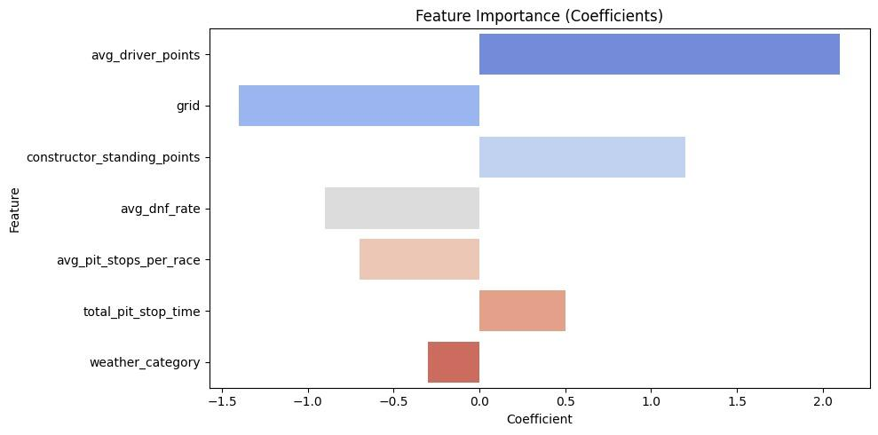
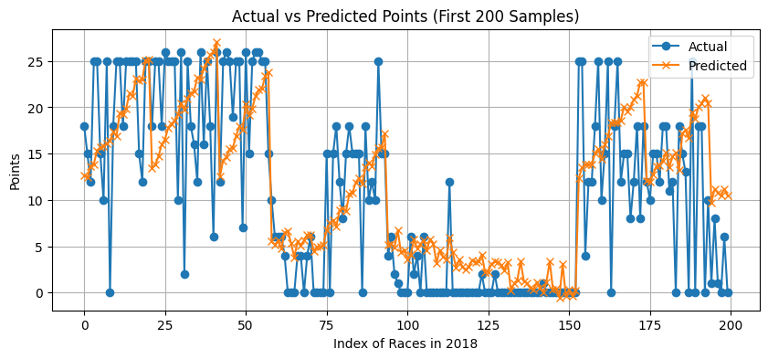
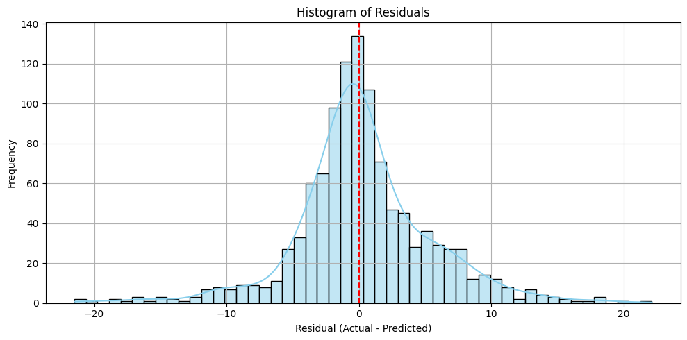

# F1 Predictive Analysis

Predicting how many points a Formula 1 driver scores in a race, using a linear regression on driver form, team
strength, grid position, track difficulty and weather.

This was a group course project (Group 5: Kartikya Saini, Sachi Sarda, Shivakshi Gupta, Shivam Soni). The
original repo is [Shivakshi26/F1_Predictive_Analysis](https://github.com/Shivakshi26/F1_Predictive_Analysis),
and the full write-up is in [`Report.pdf`](Report.pdf).

## What it is

We wanted to know which factors drive an F1 result and how far a simple, interpretable model can get. The
target is `target_points`, the points a driver scored in a race. The data is the Kaggle
"Formula 1 World Championship (1950–2020)" dataset (`rohanrao/formula-1-world-championship-1950-2020`),
downloaded inside the notebook with `kagglehub`. We added a weather label for each race that we built ourselves
from Wikipedia race pages.

## What I did

**Features.** The notebook joins `results`, `races`, `qualifying`, `pit_stops`, `constructor_standings`,
`constructors`, `drivers` and `status`, and builds one row per driver per race:

| Feature | Idea behind it |
|---|---|
| `avg_driver_points` | "absolute skill": the driver's points so far divided by races so far |
| `constructor_standing_points` | how strong the car/team is in the standings |
| `grid` | starting position (qualifying form) |
| `total_pit_stop_time` | time lost in the pits that race |
| `avg_pit_stops_per_race` | track proxy: tyre wear / strategy difficulty |
| `avg_dnf_rate` | track proxy: how often cars fail to finish there |
| `weather_category` | 0–3 label from the Wikipedia weather text (missing filled with 1.5) |


*Coefficient per feature, as plotted in [`Report.pdf`](Report.pdf) (note the positive weight on pit-stop time, discussed below).*

The weather labels are in [`wiki_with_weather_categorized.csv`](wiki_with_weather_categorized.csv): 304 races
from 2005 to 2020, with the raw Wikipedia weather string and its category.

**Model and validation.** We used ordinary least squares (`sklearn.linear_model.LinearRegression`). The split
is by time, not a random shuffle: train on seasons up to year X, test on later seasons. That way the model
never sees the future it is predicting. We swept the train/test boundary (train 2011 → 2014…2020, test up to
2020/2021/2022) to see how stable the fit was.

**Results** (from the notebook output):

| Train | Test | R² | MAE | RMSE |
|---|---|---:|---:|---:|
| 2011–2017 | 2018–2020 | **0.505** | **3.60** | **5.16** |
| 2011–2016 | 2017–2020 | 0.498 | 3.66 | 5.20 |
| 2011–2017 | 2018–2021 | 0.475 | 3.78 | 5.32 |
| 2011–2018 | 2019–2022 | 0.415 | 4.09 | 5.65 |

So the model explains about half the variance in race points on 2018–2020, with a typical error of
~3.6 points. Every split that tests on 2021 or 2022 scores lower (the report's sweep bottoms out around
0.38). The notebook also plots actual vs predicted points per season and a residual histogram, and computes
rough 95% prediction intervals with outlier flags.


*Actual vs predicted points for the first 200 driver-race rows of the 2018 test season (notebook output).*


*Distribution of residuals (actual − predicted) on the test set (notebook output).*

## What I learnt

- **A time-based split matters.** A random `train_test_split` (still visible, commented out, in the notebook)
  would let the model learn from races after the ones it is tested on.
- **Picking the "best" split is its own small leak.** We sorted the sweep by R² and reported the top row. A
  fairer headline would fix the split in advance, or report the spread (0.38–0.50).
- **Look at what actually goes into `X`.** The final model drops only `target_points` and `year`. That means
  `raceId`, `driverId` and `constructorId` went in as plain numbers, and you can see 10 coefficients instead of
  7. ID columns as numeric features carry no real meaning. Next time I'd select the feature list explicitly.
- **Linear regression doesn't know points can't be negative.** Back-markers get predictions like −2.7. A
  model that respects the 0–25 structure (or predicts finishing position and maps it to points) would fit the
  problem better.
- **Some coefficients come out "backwards".** Longer pit-stop time gets a positive weight, opposite to
  intuition. My guess is a confound: drivers who finish the race make more and longer stops than drivers
  who retire early. I'd like to test that rather than just note it.
- **The post-2021 drop needs an explanation we can test.** Our report links it to the 2021 budget cap.
  That's plausible, but we never tested it. There is also a more boring candidate I only noticed later: the
  weather labels stop at 2020, so every 2021–2022 race gets the 1.5 fill value.

## Repo structure

```text
├── F1_predicticve_analysis.ipynb      # full pipeline: download, features, model, plots
├── wiki_with_weather_categorized.csv  # hand-built weather labels per raceId
├── Report.pdf                         # course report (theory, factors, results)
└── README.md
```

## How to run

```bash
pip install kagglehub pandas numpy scikit-learn matplotlib seaborn scipy
jupyter notebook F1_predicticve_analysis.ipynb
```

The first cell downloads the Kaggle dataset (needs a Kaggle account/API token for `kagglehub`). The notebook
was written for Google Colab: one cell reads `/content/wiki_with_weather_categorized.csv`, so if you run it
locally, point that path at the CSV in this repo. The cells were not always run top to bottom: for example, the
summary-plots cell uses `feature_names`/`coefficients`, which no other cell defines. Expect to fix a stray
variable or two.
